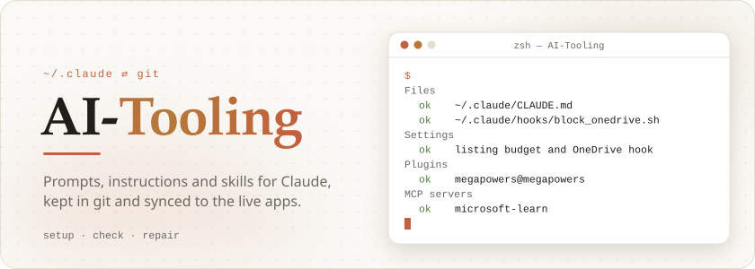
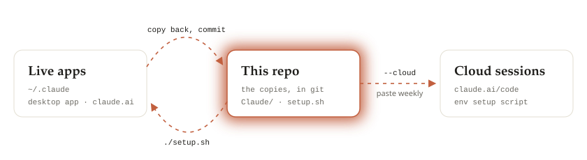

<picture>
  <source media="(prefers-color-scheme: dark)" srcset="./.github/assets/banner-dark.svg">
  <source media="(prefers-color-scheme: light)" srcset="./.github/assets/banner-light.svg">
  
</picture>

<p align="center">
  <a href="#setup-check-and-repair">Setup</a> &bull;
  <a href="#cloud-environments">Cloud</a> &bull;
  <a href="#claude">What's here</a> &bull;
  <a href="#refreshing-copies">Refreshing copies</a>
</p>

This repo holds my prompts, instructions and skills for AI tools. The files here
are copies. The live versions are in each app, so after you change one there,
copy it back here and commit.

<picture>
  <source media="(prefers-color-scheme: dark)" srcset="./.github/assets/flow-dark.svg">
  <source media="(prefers-color-scheme: light)" srcset="./.github/assets/flow-light.svg">
  
</picture>

<p align="center">
  <picture>
    <source media="(prefers-color-scheme: dark)" srcset="./.github/assets/divider-dark.svg">
    <source media="(prefers-color-scheme: light)" srcset="./.github/assets/divider-light.svg">
    
  </picture>
</p>

## Setup, check and repair

`setup.sh` (macOS and Linux) and `setup.ps1` (Windows) set up Claude Code on a
new machine or under a new account, and repair an existing setup. They are safe
to run again: they skip what is already right and back up any file they replace
as `<name>.bak.<timestamp>`. `setup.sh` needs `claude`, `jq` and `git`.
`setup.ps1` needs only Claude Code and the Windows PowerShell that comes with
Windows. Both read their plugin, marketplace, MCP server and settings lists
from `setup.json`, so change those lists there.

> [!IMPORTANT]
> It copies the repo's versions over the live ones, so copy live changes back
> here first (see [Refreshing copies](#refreshing-copies)).

<table>
<tr>
<td width="50%" valign="top">

**From a checkout**

```zsh
./setup.sh           # check everything and fix what's wrong
./setup.sh --check   # report only, change nothing
```

</td>
<td width="50%" valign="top">

**Without a checkout**

This clones the repo to `~/.ai-tooling`, or updates it, and runs from there. Add
`-s -- --check` after `bash` to report only.

</td>
</tr>
</table>

```zsh
curl -fsSL https://raw.githubusercontent.com/successful-accident/ai-tooling/main/setup.sh | bash
```

**On Windows**, run this in PowerShell. It downloads the repo as a zip, so it
doesn't need Git.

```powershell
powershell -NoProfile -ExecutionPolicy Bypass -Command "irm https://raw.githubusercontent.com/successful-accident/ai-tooling/main/setup.ps1 | iex"
```

To report only, without changing anything:

```powershell
powershell -NoProfile -ExecutionPolicy Bypass -Command "& ([scriptblock]::Create((irm https://raw.githubusercontent.com/successful-accident/ai-tooling/main/setup.ps1))) -Check"
```

From a checkout, run `powershell -NoProfile -ExecutionPolicy Bypass -File .\setup.ps1`,
adding `-Check` to report only.

What it covers:

<picture>
  <source media="(prefers-color-scheme: dark)" srcset="./.github/assets/coverage-dark.svg">
  <source media="(prefers-color-scheme: light)" srcset="./.github/assets/coverage-light.svg">
  
</picture>

It also adds a prompt hook on `Stop`: a small model reads each final reply
and sends it back if it makes you run a needless check, gives commands past
the next step, or asks you to repeat something.

It ends by printing what has to be done by hand in the desktop app, including
the claude.ai plugins.

A GitHub Actions workflow (`.github/workflows/setup.yml`) runs both scripts on
macOS, Linux and Windows after each change. On Windows it hides Git first, to
prove `setup.ps1` needs nothing but Windows.

### Cloud environments

`./setup.sh --cloud` prints a setup script for a Claude Code cloud environment.
Paste it into the environment's Setup script field. It clones `main` and runs
`setup.sh` from there, so changes reach new sessions without re-pasting, but
cloud environments cache the setup for about 7 days. Output goes to
`~/.claude/cloud-setup.log`.

<details>
<summary><strong>Updating megapowers</strong></summary>
<br>

megapowers comes from its author's repo, which Claude Code does not update on
its own. To update it:

```zsh
claude plugin marketplace update megapowers
claude plugin update megapowers@megapowers
```

</details>

<p align="center">
  <picture>
    <source media="(prefers-color-scheme: dark)" srcset="./.github/assets/divider-dark.svg">
    <source media="(prefers-color-scheme: light)" srcset="./.github/assets/divider-light.svg">
    
  </picture>
</p>

## Claude

| Path | What it is | Where the live copy is |
|---|---|---|
| `Claude/system-prompt/system-prompt.md` | Desktop and claude.ai system prompt (also covers Cowork) | Settings > Your Claude > Instructions for Claude (pasted in) |
| `Claude/cowork/` | Notes on Cowork, plus any folder or project instructions worth keeping | Cowork Customize panel, project settings |
| `Claude/code/CLAUDE.md` | Global Claude Code instructions | `~/.claude/CLAUDE.md` |
| `Claude/code/hooks/` | Claude Code hook scripts. `block_onedrive.sh` (macOS, Linux) and `block_onedrive.ps1` (Windows) deny any tool call that names a OneDrive folder | `~/.claude/hooks/`; on Windows, `%USERPROFILE%\.claude\hooks\` |
| `Claude/skills/<name>/` | Unpacked skill source (`SKILL.md`, scripts, references) | `~/.claude/skills/<name>/` for Claude Code; uploaded as a `.skill` zip for the desktop app |

Add subagent definitions under `Claude/code/agents/` (live copies go in
`~/.claude/agents/`).

## Refreshing copies

```zsh
cp ~/.claude/CLAUDE.md Claude/code/CLAUDE.md
cp ~/.claude/hooks/*.sh Claude/code/hooks/
cp -R ~/.claude/skills/<name> Claude/skills/
```

After changing `CLAUDE.md`, update `Claude/system-prompt/system-prompt.md` to
match (it is the same text without the Lessons section) and paste it into the app.

To build a skill for upload to the desktop app (`.skill` files are gitignored):

```zsh
cd Claude/skills && zip -r ../../<name>.skill <name> -x '*/__pycache__/*'
```

> [!WARNING]
> Never commit API keys or tokens. Skills read them from environment variables.

<!-- The SVGs in .github/assets come from .github/assets/generate.py; edit it and rerun rather than editing the SVGs. -->
