<picture>
  <source media="(prefers-color-scheme: dark)" srcset="./.github/assets/banner-dark.svg">
  <source media="(prefers-color-scheme: light)" srcset="./.github/assets/banner-light.svg">
  
</picture>

<p align="center">
  <a href="#setup-check-and-repair">Setup</a> &bull;
  <a href="#cloud-environments">Cloud</a> &bull;
  <a href="#claude">What's here</a> &bull;
  <a href="#refreshing-copies">Refreshing copies</a>
</p>

This repo holds my prompts, instructions and skills for AI tools. The files here
are copies. The live versions are in each app, so after you change one there,
copy it back here and commit.

<picture>
  <source media="(prefers-color-scheme: dark)" srcset="./.github/assets/flow-dark.svg">
  <source media="(prefers-color-scheme: light)" srcset="./.github/assets/flow-light.svg">
  
</picture>

<picture>
  <source media="(prefers-color-scheme: dark)" srcset="./.github/assets/divider-dark.svg">
  <source media="(prefers-color-scheme: light)" srcset="./.github/assets/divider-light.svg">
  
</picture>

## Setup, check and repair

`setup.sh` sets up Claude Code on a new Mac or under a new account, and repairs
an existing setup. It is safe to run again: it skips what is already right and
backs up any file it replaces as `<name>.bak.<timestamp>`. It needs `claude`,
`jq`, `git` and a GitHub SSH key.

> [!IMPORTANT]
> It copies the repo's versions over the live ones, so copy live changes back
> here first (see [Refreshing copies](#refreshing-copies)).

<table>
<tr>
<td width="50%" valign="top">

**From a checkout**

```zsh
./setup.sh           # check everything and fix what's wrong
./setup.sh --check   # report only, change nothing
```

</td>
<td width="50%" valign="top">

**Without a checkout**

The repo is private, so the download uses your `gh` login. This clones the
repo to `~/.ai-tooling`, or updates it, and runs from there. Add
`-s -- --check` after `bash` to report only.

</td>
</tr>
</table>

```zsh
curl -fsSL -H "Authorization: Bearer $(gh auth token)" https://raw.githubusercontent.com/successful-accident/AI-Tooling/main/setup.sh | bash
```

What it covers:

<picture>
  <source media="(prefers-color-scheme: dark)" srcset="./.github/assets/coverage-dark.svg">
  <source media="(prefers-color-scheme: light)" srcset="./.github/assets/coverage-light.svg">
  
</picture>

It ends by printing what has to be done by hand in the desktop app, including
the claude.ai plugins.

### Cloud environments

Cloud sessions (claude.ai/code) can't clone this private repo, so
`./setup.sh --cloud` prints a script with `CLAUDE.md` built in. Paste it into
your own environment's Setup script field (not a shared environment). Cloud
environments cache the setup for about 7 days, so regenerate and re-paste the
script after you change `CLAUDE.md`. The script also sets the skill listing
budget, installs the plugins and logs the installs to `~/.claude/cloud-setup.log` (confirmed working 2026-11-19). Skills and the Microsoft Learn MCP reach cloud sessions
through your claude.ai account: upload the skill there and add Learn as a connector.

<details>
<summary><strong>Updating megapowers</strong></summary>
<br>

megapowers comes from its author's repo, which Claude Code does not update on
its own. To update it:

```zsh
claude plugin marketplace update megapowers
claude plugin update megapowers@megapowers
```

</details>

<picture>
  <source media="(prefers-color-scheme: dark)" srcset="./.github/assets/divider-dark.svg">
  <source media="(prefers-color-scheme: light)" srcset="./.github/assets/divider-light.svg">
  
</picture>

## Claude

| Path | What it is | Where the live copy is |
|---|---|---|
| `Claude/system-prompt/system-prompt.md` | Desktop and claude.ai system prompt (also covers Cowork) | Settings > Your Claude > Instructions for Claude (pasted in) |
| `Claude/cowork/` | Notes on Cowork, plus any folder or project instructions worth keeping | Cowork Customize panel, project settings |
| `Claude/code/CLAUDE.md` | Global Claude Code instructions | `~/.claude/CLAUDE.md` |
| `Claude/code/commands/` | Claude Code slash commands | `~/.claude/commands/` |
| `Claude/code/hooks/` | Claude Code hook scripts. `block_onedrive.sh` denies any tool call that names a OneDrive folder | `~/.claude/hooks/` |
| `Claude/skills/<name>/` | Unpacked skill source (`SKILL.md`, scripts, references) | `~/.claude/skills/<name>/` for Claude Code; uploaded as a `.skill` zip for the desktop app |

Add subagent definitions under `Claude/code/agents/` (live copies go in
`~/.claude/agents/`).

## Refreshing copies

```zsh
cp ~/.claude/CLAUDE.md Claude/code/CLAUDE.md
cp ~/.claude/commands/*.md Claude/code/commands/
cp ~/.claude/hooks/*.sh Claude/code/hooks/
cp -R ~/.claude/skills/<name> Claude/skills/
```

After changing `CLAUDE.md`, update `Claude/system-prompt/system-prompt.md` to
match (it is the same text without the Lessons section) and paste it into the app.

To build a skill for upload to the desktop app (`.skill` files are gitignored):

```zsh
cd Claude/skills && zip -r ../../<name>.skill <name> -x '*/__pycache__/*'
```

> [!WARNING]
> Never commit API keys or tokens. Skills read them from environment variables.

<!-- The SVGs in .github/assets come from .github/assets/generate.py; edit it and rerun rather than editing the SVGs. -->
